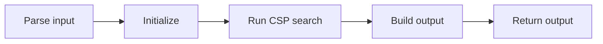

# Architecture

TinyScheg runs as a pipeline of five stages:

## 1. Parse input

> [!WARNING]
> **Not yet implemented.**

Read the YAML input file (see [Input format](../reference/input-format.md)) and turn it into objects:

* each worker entry becomes a [`Worker`](../reference/api/worker.md);
* each post entry becomes a [`Post`](../reference/api/post-and-slot.md#class-postname-length-roles-periodnone-variationsnone).
  This includes converting daily time windows (e.g. `"19:00-07:00"`) into concrete date-time ranges over the
  schedule period, and filling in each variation's unspecified fields from the post's general case.

The input is also **validated**: names are unique, every name in a likes/dislikes list refers to an existing worker,
a worker isn't in their own lists, no worker name contains `" & "`, nobody is both liked and disliked by the same worker, and a post's variations
don't overlap. Invalid input is reported before anything else happens.

## 2. Initialize

> [!IMPORTANT]
> **Partially implemented.** The building blocks exist (`Post.gen_slot_list`, `Slot` domain building and
> `Slot.gen_time_constraints`), but nothing ties them together yet.

Set up the CSP:

1. Generate the slots of every post over the schedule period, segment by segment (see
   [Domain model](domain-model.md#shifts-and-slots)), in their stable order.
2. Build each slot's domain: the workers who satisfy its unary constraints (availability, role).
3. Generate the binary difference constraints between slots, using the minimum rest period from the settings.
4. Calculate the constants used by scoring: each worker's availability, the number of shared slots, and each
   worker's worst rest deficit and packable maximum (see [Scoring](scoring.md)).
5. If any slot's domain is already empty, no legal schedule exists: report it and stop.

See [Domain model](domain-model.md) and [CSP formulation](csp-formulation.md).

## 3. Run CSP search

> [!WARNING]
> **Not yet implemented.**

Search for the best schedule: a backtracking search with constraint propagation, ordered by MRV and the degree
heuristic, pruned by comparing each partial schedule's penalty against the best complete schedule found so far.
See [Search algorithm](search-algorithm.md) and [Scoring](scoring.md).

## 4. Build output

> [!WARNING]
> **Not yet implemented.**

Transform the best schedule's list of assigned slots into a grid of time against post, written as CSV, XLSX or ODS
(see [Output format](../reference/output-format.md)).

## 5. Return output

> [!WARNING]
> **Not yet implemented.**

Write or return the output.

## Code layout

The code is the `tinyscheg` package in `src/tinyscheg/`, split into subpackages by domain. `src/main.py` is a thin
entry point. Modules marked *planned* don't exist yet.

| Module | Contents |
|--------|----------|
| `cli.py` | *Planned.* Command-line interface; runs the pipeline end to end. |
| `timing/datetime_range.py` | [`DateTimeRange`](../reference/api/datetime-range.md) and `parse_range`. |
| `timing/daily_window.py` | *Planned.* Recurring `"HH:MM-HH:MM"` windows, turned into concrete ranges over a period. |
| `model/worker.py` | [`Worker`](../reference/api/worker.md). |
| `model/shift.py` | [`Post` and `Slot`](../reference/api/post-and-slot.md); to become plain, immutable `Shift` and `Slot` descriptions, with `Post` moving to `model/post.py`. |
| `model/post.py` | *Planned.* `Post` and its variations. |
| `model/shift_generation.py` | *Planned.* Segments, shifts and slots in stable order ([ADR 0018](../decisions/0018-slot-generation-by-segments.md)). |
| `parsing/input_reader.py` | *Planned.* YAML input to model objects. |
| `parsing/validation.py` | *Planned.* Input validation rules. |
| `csp/problem.py` | *Planned.* Domains and difference constraints, by slot index. |
| `csp/state.py` | *Planned.* The explicit search state and change records ([ADR 0016](../decisions/0016-undo-through-change-records-on-the-call-stack.md)). |
| `csp/search.py` | *Planned.* Backtracking search with forward checking and MRV/degree ordering. |
| `output/grid.py` | *Planned.* Assigned slots to the time-by-post grid ([ADR 0019](../decisions/0019-output-as-a-time-by-post-grid.md)). |
| `output/csv_writer.py` | *Planned.* The grid as CSV; XLSX and ODS writers will sit next to it. |

Dependencies point one way: `timing` ← `model` ← (`parsing`, `csp`, `output`), with `cli` using all of them.
`parsing`, `csp` and `output` don't import each other. A planned `scoring` package will depend only on `model` and be
used by `csp`.

Tests live in `tests/`, one test file per module, plus an independent schedule checker that verifies every hard
constraint of a search result.
