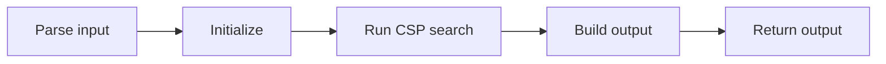

# Architecture

TinyScheg runs as a pipeline of five stages:

## 1. Parse input

> [!WARNING]
> **Not yet implemented.**

Read the YAML input file (see [Input format](../reference/input-format.md)) and turn it into objects:

* each worker entry becomes a [`Worker`](../reference/api/worker.md);
* each post entry becomes a [`Post`](../reference/api/post-and-slot.md#class-postname-length-roles-periodnone-variationsnone).
  This includes converting daily time windows (e.g. `"19:00-07:00"`) into concrete date-time ranges over the
  schedule period, and filling in each variation's unspecified fields from the post's general case.

## 2. Initialize

> [!IMPORTANT]
> **Partially implemented.** The building blocks exist (`Post.gen_slot_list`, `Slot` domain building and
> `Slot.gen_time_constraints`), but nothing ties them together yet.

Set up the CSP:

1. Set `Slot.worker_list` to all workers.
2. Generate the slots of every post over the schedule period with `Post.gen_slot_list`. Each slot's domain is
   pruned by unary constraints (availability, role) as it's created.
3. Sort all slots by time and generate the binary difference constraints with `Slot.gen_time_constraints`, using
   the minimum rest period from the settings.

See [Domain model](domain-model.md) and [CSP formulation](csp-formulation.md).

## 3. Run CSP search

> [!WARNING]
> **Not yet implemented.**

Search for the best schedule: a backtracking search with constraint propagation, ordered by MRV and the degree
heuristic, pruned by comparing each partial schedule's penalty against the best complete schedule found so far.
See [Search algorithm](search-algorithm.md) and [Scoring](scoring.md).

## 4. Build output

> [!WARNING]
> **Not yet implemented.**

Transform the best schedule's list of assigned slots into the output CSV (see
[Output format](../reference/output-format.md)).

## 5. Return output

> [!WARNING]
> **Not yet implemented.**

Write or return the output.

## Code layout

All code currently lives directly in `src/`:

| File                  | Contents |
|-----------------------|----------|
| `src/DateTimeRange.py`| [`DateTimeRange`](../reference/api/datetime-range.md) and `parse_range` |
| `src/Worker.py`       | [`Worker`](../reference/api/worker.md) |
| `src/shift.py`        | [`Post` and `Slot`](../reference/api/post-and-slot.md) |
| `src/main.py`         | Entry point (empty) |

Planned classes not yet in code: `Scorer`, `Trail` and `Schedule`.
