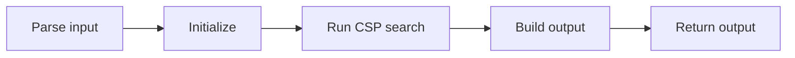

# Architecture

TinyScheg runs as a pipeline of five stages:

## 1. Parse input

> [!NOTE]
> **Implemented.** See [`parsing`](../reference/api/parsing.md).

Read the YAML input file (see [Input format](../reference/input-format.md)) and turn it into objects:

* each worker entry becomes a [`Worker`](../reference/api/worker.md);
* each post entry becomes a [`Post`](../reference/api/post-and-slot.md#post-module), with its daily time windows
  (e.g. `"19:00-07:00"`) as [`DailyWindow`](../reference/api/daily-window.md)s and each variation's unspecified
  fields filled in from the post's general case;
* the settings become [`Settings`](../reference/api/schedule-input.md), and everything together a `ScheduleInput`;
* each [`history`](../reference/input-format.md#history) entry, a previous schedule's input and schedule file, is read
  too, into a `PreviousSchedule`.

The input is also **validated** (all problems are reported together; see
[Input format](../reference/input-format.md#errors)): names are unique, every name in a likes/dislikes list refers to an existing worker,
a worker isn't in their own lists, no worker name contains `" & "`, nobody is both liked and disliked by the same worker, a post's variations
don't overlap, and the history's periods end by the time this one starts and don't overlap each other. Invalid input
is reported before anything else happens.

## 2. Initialize

> [!NOTE]
> **Implemented.** Steps 1–3 and 5 by [`Problem`](../reference/api/problem.md) (step 5 is reported by the
> [command line](../reference/command-line.md)), step 4 by [`scoring.constants`](../reference/api/scoring.md#constants-module).

Set up the CSP:

1. Generate the slots of every post over the schedule period, segment by segment (see
   [Domain model](domain-model.md#shifts-and-slots)), in their stable order. With a history, the previous schedules'
   shifts come first, already filled ([ADR 0031](../decisions/0031-history-as-the-filled-part-of-one-schedule.md)).
2. Build each slot's domain: the workers who satisfy its unary constraints (availability, role).
3. Generate the binary difference constraints between slots, using the minimum rest period from the settings.
4. Calculate the constants used by scoring: each worker's availability and worst rest deficit, each slot's load,
   the number of shared slots, the rest factor derived from the input, and the units the penalty's parts are
   measured in (see [Scoring](scoring.md)).
5. If any slot's domain is already empty, no legal schedule exists: report every such slot and stop, writing no
   output ([ADR 0020](../decisions/0020-report-where-infeasibility-was-found.md)).

See [Domain model](domain-model.md) and [CSP formulation](csp-formulation.md).

## 3. Run CSP search

> [!NOTE]
> **Implemented** ([`csp/search.py`](../reference/api/search.md)): the best legal schedule, or where the search got
> stuck if there's none.

Search for the best schedule: a backtracking search with forward checking, slots ordered by MRV and the degree
heuristic and workers tried cheapest first, pruned by comparing a lower bound on each partial schedule's penalty
against the best complete schedule found so far, in parallel processes by default. Its progress is reported as it
goes, and Ctrl+C stops it, keeping the best schedule found. See [Search algorithm](search-algorithm.md) and
[Scoring](scoring.md).

## 4. Build output

> [!NOTE]
> **Implemented.** The grid and the CSV, XLSX and ODS writers ([`output`](../reference/api/output.md)).

Transform the best schedule's list of assigned slots into a grid of time against post, written as CSV, XLSX or ODS
(see [Output format](../reference/output-format.md)). The grid is an internal table that knows nothing about file
formats; each format has a writer that translates it.

## 5. Return output

> [!NOTE]
> **Implemented.** See [Command line](../reference/command-line.md).

Write the grid to the output file, in the format its extension names (with a history, the new period only), and
report what was written and the schedule's penalty. If no legal schedule was found, nothing is written, and the
problem is reported instead ([ADR 0020](../decisions/0020-report-where-infeasibility-was-found.md)).

## Code layout

The code is the `tinyscheg` package in `src/tinyscheg/`, split into subpackages by domain. `src/main.py` is a thin
entry point.

| Module | Contents |
|--------|----------|
| `cli.py` | [Command-line interface](../reference/command-line.md); runs the pipeline end to end. |
| `timing/datetime_range.py` | [`DateTimeRange`](../reference/api/datetime-range.md) and `parse_range`. |
| `timing/daily_window.py` | [`DailyWindow`](../reference/api/daily-window.md): recurring `"HH:MM-HH:MM"` windows, turned into concrete ranges over a period. |
| `model/worker.py` | [`Worker`](../reference/api/worker.md). |
| `model/shift.py` | [`Shift` and `Slot`](../reference/api/post-and-slot.md#shift-module): plain, immutable descriptions. |
| `model/post.py` | [`Post`, `Variation` and `ShiftRules`](../reference/api/post-and-slot.md#post-module). |
| `model/schedule_input.py` | [`Settings`, `ScoringParameters` and `ScheduleInput`](../reference/api/schedule-input.md): the parsed input as a whole, and the scoring defaults. |
| `model/shift_generation.py` | [Segments, shifts and slots in stable order](../reference/api/post-and-slot.md#shift_generation-module) ([ADR 0018](../decisions/0018-slot-generation-by-segments.md)). |
| `parsing/input_reader.py` | [`read_input`](../reference/api/parsing.md#input_reader-module): YAML input to model objects. |
| `parsing/validation.py` | [`InputError` and the validation rules](../reference/api/parsing.md#validation-module). |
| `parsing/schedule_reader.py` | [`read_schedule`](../reference/api/parsing.md#schedule_reader-module): a written schedule file (CSV, XLSX or ODS) back to assignments. |
| `csp/problem.py` | [`Problem`](../reference/api/problem.md): domains and difference constraints, by slot and worker index. |
| `csp/state.py` | [The explicit search state and change records](../reference/api/search.md#state-module) ([ADR 0016](../decisions/0016-undo-through-change-records-on-the-call-stack.md)). |
| `csp/search.py` | [Backtracking search with forward checking](../reference/api/search.md#search-module): MRV/degree ordering, branch and bound, and the search's progress. |
| `csp/parallel.py` | [Branch and bound in parallel processes](../reference/api/search.md#parallel-module), with the same result (ADR 0041). |
| `scoring/constants.py` | [The constants of the penalty score](../reference/api/scoring.md#constants-module), calculated once per run. |
| `scoring/penalty.py` | [The penalty of a (partial) schedule](../reference/api/scoring.md#penalty-module): likes, workload, rest and their weighted sum. |
| `scoring/whole_slots.py` | [The workload bound in whole slots](../reference/api/scoring.md#whole_slots-module) (ADR 0040). |
| `scoring/incremental.py` | [Incremental scoring](../reference/api/scoring.md#incremental-module): running totals of the penalty and its bound, to steer the search (ADR 0027). |
| `output/grid.py` | [Assigned slots to the time-by-post grid](../reference/api/output.md#grid-module) ([ADR 0019](../decisions/0019-output-as-a-time-by-post-grid.md)). |
| `output/writers.py` | [Choosing the format by extension](../reference/api/output.md#writers-module), and `write_schedule`. |
| `output/csv_writer.py` | [The grid as CSV](../reference/api/output.md#csv_writer-module). |
| `output/xlsx_writer.py` | [The grid as an Excel workbook](../reference/api/output.md#xlsx_writer-module), with openpyxl. |
| `output/ods_writer.py` | [The grid as an OpenDocument spreadsheet](../reference/api/output.md#ods_writer-module), with odfpy. |

Dependencies point one way: `timing` ← `model` ← (`parsing`, `scoring`, `output`), `scoring` ← `csp`, with `cli`
using all of them. `parsing`, `csp` and `output` don't import each other; `scoring` depends only on `model` and
`timing`, and `csp` uses it for branch and bound.

Tests live in `tests/`, one test file per module. Development tools live in `tools/`, outside the package: the
independent schedule checker that verifies every hard constraint of a search result (`schedule_checker.py`), the
[schedule audit](schedule-audit.md) (`audit.py`, `audit_sample.py`), the [tuning](tuning.md) runner and benchmark
generator (`tune.py`, `benchmarks/generate.py`), and the [PyPy setup](../how-to/use-pypy.md) (`setup_pypy.py`).
