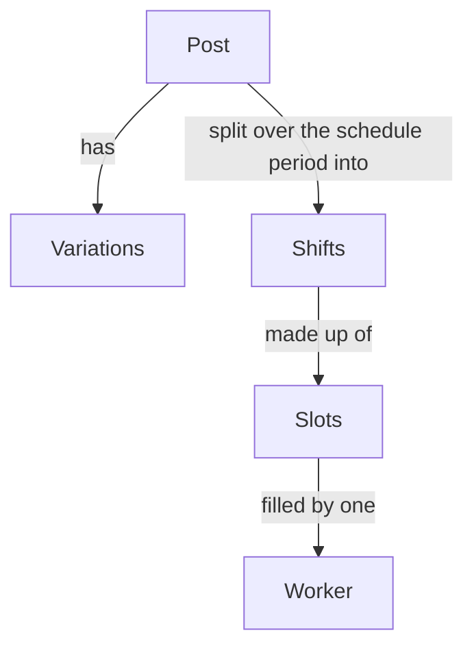

# Domain model

TinyScheg describes a schedule with a few concepts that build on one another.

## Workers

> [!NOTE]
> **Implemented.** See [`Worker`](../reference/api/worker.md).

A **worker** is someone who can be assigned to shifts. Each worker has:

* **roles** — qualifications that some slots require (e.g. "supervisor");
* **unavailability** — date-time ranges during which they can't work. Workers are available at all other times;
* **likes** and **dislikes** — workers they'd like, or rather not, share a shift with. These are soft preferences
  that affect the [score](scoring.md), not hard constraints.

The role `any` is a wildcard: every worker has it, including workers with no roles at all.

## Posts

> [!NOTE]
> **Implemented.** See [`Post`](../reference/api/post-and-slot.md#post-module) and
> [`DailyWindow`](../reference/api/daily-window.md).

A **post** is something that needs to be manned, such as "front gate" or "desk". A post is a **template**: it
describes what's needed, not who does it or when exactly. Each post defines:

* the **roles** it needs, and how many workers of each — the total number of workers is the sum of these counts;
* the **length** of each shift;
* optionally, a daily **time window** during which it's active (otherwise it's always active).

### Variations

A post may have **variations**: recurring daily time windows during which its requirements change. For example, a
front gate normally manned by one worker might need two at night, one of them with the security role. A variation
can override the roles and the shift length; anything it doesn't specify is inherited from the post's general case.

## Shifts and slots

> [!NOTE]
> **Implemented.** See [`Shift`, `Slot` and shift generation](../reference/api/post-and-slot.md#shift-module).

Over the schedule period, each post is split into **shifts**
([ADR 0018](../decisions/0018-slot-generation-by-segments.md)):

1. The period is split into **segments** at every boundary where the post's rules change: the schedule's start and
   end, the openings and closings of the post's daily activity window, and the starts and ends of its variations.
   Windows that cross midnight count from the day they open, so a window that opened the day before the schedule
   starts still applies. A variation only applies where its post is active.
2. Within a segment the rules are constant: those of the variation in effect, otherwise the post's general case.
3. In each segment, shifts are laid back to back from the segment's start. If the segment isn't a multiple of the
   shift length, the last shift is cut off at the segment's end (a shorter, "dangling" shift).

For example, with 3-hour shifts and a 19:00–07:00 night variation, a schedule starting at midnight gets night
shifts 00–03, 03–06 and 06–07, then day shifts 07–10, 10–13, 13–16 and 16–19, then night shifts from 19:00. No
shift ever crosses a boundary where the requirements change.

Each shift is made up of **slots**, one per required worker. A slot is a single position for a single worker at a
specific time, with a single required role. For example, a night shift at the front gate requiring
`{security: 1, any: 1}` consists of two slots: one requiring the security role and one that any worker can fill.

Each slot belongs to a shift, and a shift knows its slots. This grouping matters for the likes/dislikes part of
[scoring](scoring.md), which looks at who shares a shift, and for the [output](../reference/output-format.md), which
shows each shift's workers together. Shifts and slots are plain, unchanging descriptions: who is assigned to them, and
which workers can still be, is part of the search state, not of the slots themselves. A variation requiring no workers
produces no shifts, closing the post during its window.

Slots have a fixed, stable order: by start time, end time, the post's position in the input, the role's position in
the post's role list, and index. This order is used wherever ties need breaking, so that the same input always
produces the same schedule ([ADR 0012](../decisions/0012-deterministic-path-independent-scoring.md)).

Slots are the unit TinyScheg actually schedules: they are the variables of the
[CSP](csp-formulation.md).

## Schedule

> [!NOTE]
> **Implemented.** See [`SearchState`](../reference/api/search.md#class-searchstateproblem) and
> [`SearchResult`](../reference/api/search.md#class-searchresultassignment-deepest-stuck_slot-penaltynone-nodes0-pruned0-completetrue-finished10).

A **schedule** is an assignment of workers to slots: a worker index per slot, in stable slot order. While searching,
the current (partial) schedule is part of the explicit [search state](search-algorithm.md#search-state); the
[change records](search-algorithm.md#undo) used to undo assignments are kept by the search itself, not by the
schedule. The best complete schedule found is written as the [output](../reference/output-format.md).

A schedule can continue earlier ones: with a [history](../reference/input-format.md#history), the previous schedules'
shifts are the already-filled first part of one schedule, which the search completes
([ADR 0031](../decisions/0031-history-as-the-filled-part-of-one-schedule.md)).
