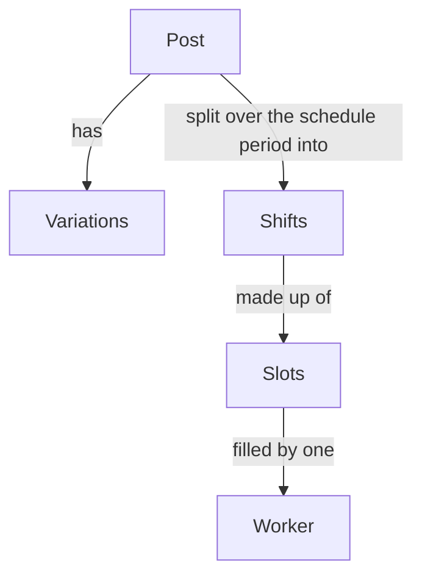

# Domain model

TinyScheg describes a schedule with a few concepts that build on one another.

## Workers

> [!IMPORTANT]
> **Partially implemented.** See [`Worker`](../reference/api/worker.md).

A **worker** is someone who can be assigned to shifts. Each worker has:

* **roles** — qualifications that some slots require (e.g. "supervisor");
* **unavailability** — date-time ranges during which they can't work. Workers are available at all other times;
* **likes** and **dislikes** — workers they'd like, or rather not, share a shift with. These are soft preferences
  that affect the [score](scoring.md), not hard constraints.

The role `any` is a wildcard: every worker has it, including workers with no roles at all.

## Posts

> [!NOTE]
> **Implemented.** See [`Post`](../reference/api/post-and-slot.md).

A **post** is something that needs to be manned, such as "front gate" or "desk". A post is a **template**: it
describes what's needed, not who does it or when exactly. Each post defines:

* the **roles** it needs, and how many workers of each — the total number of workers is the sum of these counts;
* the **length** of each shift;
* optionally, a daily **time window** during which it's active (otherwise it's always active).

### Variations

A post may have **variations**: recurring daily time windows during which its requirements change. For example, a
front gate normally manned by one worker might need two at night, one of them with the security role. A variation
can override the roles and the shift length; anything it doesn't specify is inherited from the post's general case.

## Shifts and slots

> [!IMPORTANT]
> **Partially implemented.** See [`Slot`](../reference/api/post-and-slot.md#class-slottime-role-post).

Over the schedule period, each post is split into consecutive **shifts**. Starting from the beginning of the
period, each shift's length and requirements are taken from the variation in effect at its start time, and the next
shift starts when it ends.

Each shift is made up of **slots**, one per required worker. A slot is a single position for a single worker at a
specific time, with a single required role. For example, a night shift at the front gate requiring
`{security: 1, any: 1}` consists of two slots: one requiring the security role and one that any worker can fill.

Slots of the same shift are linked to one another (`Slot.same_shift`). This grouping matters for the
likes/dislikes part of [scoring](scoring.md), which looks at who shares a shift.

Slots are the unit TinyScheg actually schedules: they are the variables of the
[CSP](csp-formulation.md).

## Schedule

> [!WARNING]
> **Not yet implemented.**

A **schedule** is an assignment of workers to slots. A planned `Schedule` class will hold the list of slots (in the
order the CSP algorithm processes them) together with the [`Trail`](search-algorithm.md#trail) used to undo
assignments while searching.
